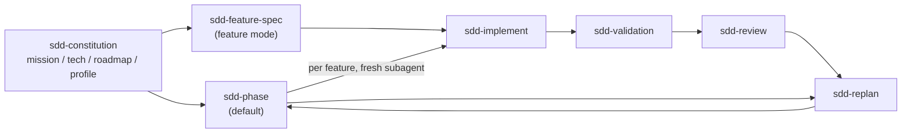

# SDD Conventions (generic, project-agnostic)

> Every `sdd-*` skill follows these rules. Anything **project-specific** (commands, sensitive areas, review lenses, numbering, language) lives in the project's **`spec/sdd-profile.md`**, never in the skills.
> Templates: `.agents/skills/sdd-conventions/templates/`.

---

## 0. Project Profile — read it first
Every `sdd-*` skill starts by reading `spec/sdd-profile.md` in the current project.
- **Missing?** Discover the values from the repo (manifests such as `pyproject.toml`, `package.json`, `go.mod`, `Cargo.toml`, `pom.xml`; lockfiles; CI workflows; `README`; test folders), draft the profile from [`templates/sdd-profile.md`](templates/sdd-profile.md), confirm the uncertain values with the human, and save it. `sdd-constitution` does this as part of its run.
- The profile is part of the constitution: change it through `sdd-replan` (mode C or E).
- If a skill below says "`<profile: X>`", use the value of section X of the profile.

---

## 1. Lifecycle & Execution Modes

| Mode | Default? | Skills | Gates |
|:---|:---|:---|:---|
| **Phase mode** | ✅ (unless the profile says otherwise) | `sdd-phase` (orchestrates the others) | Phase Gate 1 (all specs of the phase) → Phase Gate 2 (push + merge) |
| **Feature mode** | For `<profile: Sensitive Areas>` or when the human asks | `sdd-feature-spec` → `sdd-implement` → `sdd-validation` → `sdd-review` | Gates 1–3 |

| Skill | Use when |
|:---|:---|
| `sdd-constitution` | Creating/regenerating `spec/mission.md`, `spec/tech.md`, `spec/roadmap.md`, `spec/sdd-profile.md` (greenfield or brownfield) |
| `sdd-phase` | **Default**: plan + implement + validate a whole roadmap phase with two gates |
| `sdd-feature-spec` | A single feature (sensitive or on request) |
| `sdd-implement` | Spec approved → write code (directly, or as a per-feature subagent of `sdd-phase`) |
| `sdd-validation` | Write `validation.md` (spec mode) or run it (execute mode) |
| `sdd-review` | 5-question review, optional deep review, gates, commit |
| `sdd-changelog` | Stakeholder-friendly `CHANGELOG.md` updates |
| `sdd-replan` | Between features/phases, change of direction, constitution/process updates |
| `sdd-research-backlog` | Park an idea/research without derailing the current scope |

---

## 2. Sources of Truth
- **`spec/` is the single source of truth** for intent: `mission.md`, `tech.md`, `roadmap.md`, `sdd-profile.md`, optional `architecture.md`, `adr/`, `security/`, plus `features/`, `phases/`, `backlog/`.
- `spec/archive/` is historical: never read it for decisions, never update it.
- Agents are stateless: re-read spec files from disk at the start of every skill. Never rely on memory of an earlier conversation.
- **No-drift rule**: every human-requested change goes into the **spec first**, then the code, in the same step. Never change code alone. Never rename or move files without updating every spec/README reference.

---

## 3. Identity & Folders
- Roadmap ID: `Feature <phase>.<n>`.
- Feature folder: `<profile: Feature Folder Pattern>`, default `spec/features/feature-<phase><nn>-<kebab-slug>/` (two-digit `<nn>`). On a collision with an existing folder, take the next free number. `plan.md` must always state `Roadmap ID: Feature X.Y`.
- Feature folder files: `plan.md`, `requirements.md`, `validation.md`. Optional: `review.md`, and a summary in the human's language (`summary_<lang>.md`).
- Phase folder (phase mode): `spec/phases/phase-<N>-<kebab-slug>/` containing `phase-overview.md` and `phase-review.md`.

---

## 4. Git Strategy (override only via the profile)
| Work type | Branch | From | Merged to the main branch |
|:---|:---|:---|:---|
| Roadmap phase | `phase/<N>-<kebab-slug>` | latest main branch | When every feature of the phase is done and Phase Gate 2 (or the phase-close replan) is approved |
| Constitution / roadmap / process change | `replan/<kebab-topic>` | latest main branch | After the replan is approved |

- One commit per feature (Conventional Commits: `feat(<scope>): implement Feature X.Y <title>`). Spec commits may be separate (`docs(spec): …`).
  - Feature mode: commit after Gate 2.
  - Phase mode: **local** commit once the feature is validated and the orchestrator has verified it. Changes requested at Phase Gate 2 become additional `fix(...)` commits; no history rewriting.
- **Push only after Gate 2 / Phase Gate 2.** Never force-push. Never commit secrets or `.env` files.
- A roadmap checkbox tick may ride on the feature commit. Anything bigger goes to a `replan/` branch.
- Before creating or switching branches: the working tree must be clean, or the human decides what happens to uncommitted work. Never stash or discard human work silently.
- No git repo or no remote? Report it and skip the git steps that need them; don't initialise anything without asking.

---

## 5. Human-in-the-Loop Gates
**Feature mode**

| Gate | Agent stops after… | Unlocks |
|:---|:---|:---|
| Gate 1 | `plan.md`, `requirements.md`, `validation.md` written | implement |
| Gate 2 | implementation + validation run + review report | commit & push |
| Gate 3 | commit + push + changelog, with a quick roadmap check | next feature |

**Phase mode**

| Gate | Agent stops after… | Unlocks |
|:---|:---|:---|
| Phase Gate 1 | phase interview + `phase-overview.md` + all feature specs | implement the whole phase |
| Phase Gate 2 | all features committed locally + phase integration validation + deep review + `phase-review.md` | push + merge |
| Unplanned stop | a feature stays red after 2 fix attempts, or a fix needs a change to intent, scope, or a `tech.md` invariant | human decision, then resume |

- Approval words: `<profile: Approval Words>` (default: `approved`, `go ahead`, `proceed`, plus their equivalents in the human's language).
- Anything else (questions, "looks good but…", requested changes) is **not** approval: apply changes (spec first), re-present, wait.
- Never skip a gate.

---

## 6. Language
- Skills, spec files, code, and commits: `<profile: Artifact Language>` (default English).
- Messages to the human: `<profile: Conversation Language>` (default: the language the human writes in). Technical terms, paths, and code stay as-is.

---

## 7. Clean-Slate Checklist (start of every feature or phase)
1. The working tree is clean (or the human decided what to do).
2. The previous feature/phase is committed (and pushed if approved).
3. The right branch is checked out (current `phase/…`, or a new one from the main branch).
4. The next roadmap item still makes sense (quick replan check).
5. Recommend a **fresh conversation / cleared context**, so that the spec, not chat memory, carries intent.

---

## 8. Right Level of Detail
Treat the agent as a highly capable pair programmer.
- **Write**: goals, why, scope/exclusions, user flows, constraints, `tech.md` invariants, success criteria, decisions and trade-offs.
- **Don't write**: variable names, trivial internal structure, line-level instructions.
- Every requirement is testable and traced to a validation check.

---

## 9. Commands
Never hard-code or guess commands. Use `<profile: Commands>` and verify they still exist in the repo before relying on them. A missing capability (e.g. no type checker) means that tier is `Not Applicable` with a justification, until it is added via `sdd-replan`.

