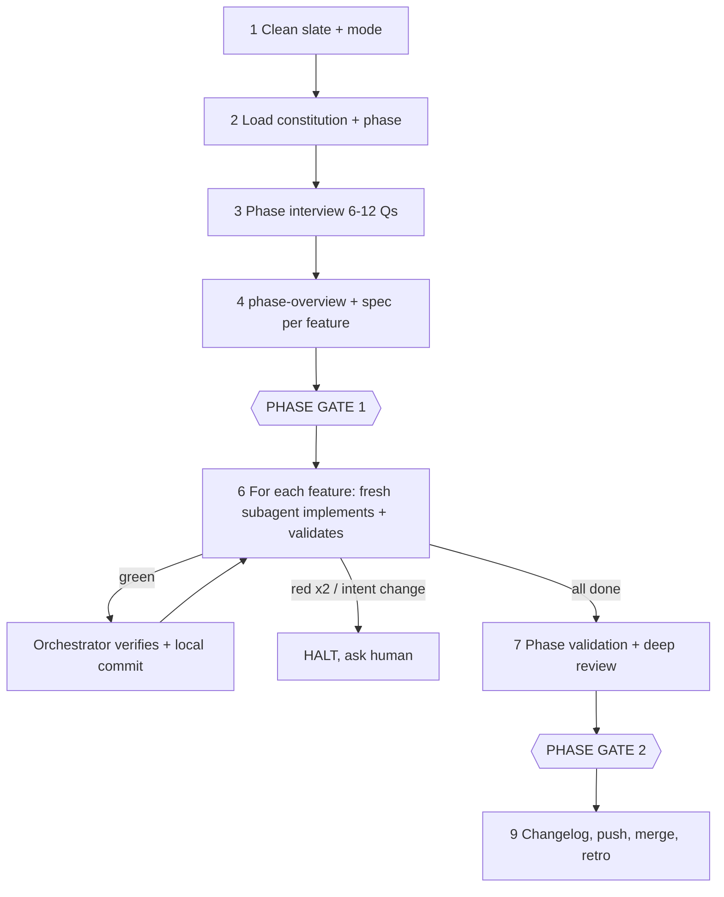

# sdd-phase — One Phase, Two Gates

Rules: read `.agents/skills/sdd-conventions/SKILL.md` (CONV) and the project's `spec/sdd-profile.md` (PROFILE) first. This skill orchestrates the other `sdd-*` skills; it doesn't replace their rules.

## Step 1 — Clean Slate & Mode
1. Run the CONV §7 checklist. Branch: `phase/<N>-<slug>` from the latest main branch, or continue it if the phase already started.
2. Treat uncommitted work that belongs to this phase as existing code: inspect it and include it in the relevant feature spec. Never discard it.
3. If any feature touches PROFILE "Sensitive Areas", recommend feature mode for those features. The human decides.
4. No `spec/sdd-profile.md` or no constitution? Run `sdd-constitution` first.

## Step 2 — Load Context From Disk
`spec/mission.md`, `spec/tech.md`, `spec/roadmap.md` (target phase), `spec/sdd-profile.md`, optional `spec/architecture.md`, `spec/adr/`, `spec/security/`, open `spec/backlog/` items, existing feature folders of this phase, and the source files the phase will touch. Never `spec/archive/`.

## Step 3 — Phase Interview (6–12 questions, in batches)
Each question has a recommended answer first (use a question tool if available).
- **Batch 1, phase level**: scope in/out, merging/splitting/reordering features, shared technical decisions, validation strategy (manual checks? real external calls?), sensitive-area mode choice.
- **Batch 2, per feature**: only what's genuinely open.
Already decided by the constitution, ADRs, or an approved spec → don't ask; record it as a decision with its source.

## Step 4 — Write the Phase Spec
1. `spec/phases/phase-<N>-<slug>/phase-overview.md` ← `templates/phase-overview.md` (in sdd-conventions).
2. For each unfinished feature, the three files per `sdd-feature-spec` Step 6 rules and `sdd-validation` spec mode. Update existing specs for consistency; don't rewrite what is still valid.
3. Cross-check: no scope overlap; interfaces between features are defined; every requirement is traced to validation.
4. Roadmap edits stay within this phase's section and are listed for the human.

## Step 5 — 🛑 PHASE GATE 1
Present in the conversation language: phase goal, feature order, shared decisions, key per-feature decisions, risks, stop conditions, file links. Changes → update the overview and all affected specs consistently, then present again. After approval: local commit `docs(spec): add Phase N specs`.

## Step 6 — Orchestrated Implementation (no stops between features)
For each feature, in order:
1. **Launch a fresh subagent** (same capabilities and workspace) with a prompt like:
   > Implement Feature X.Y with the `sdd-implement` skill and `sdd-validation` execute mode. Spec: `spec/features/<folder>/`. Phase context: `spec/phases/<phase>/phase-overview.md`. Profile: `spec/sdd-profile.md`. Read everything from disk. Stay strictly in scope. Do NOT commit, push, or tick the roadmap. If validation stays red after 2 fix attempts, or the fix needs a change to intent, scope, or a `tech.md` invariant, STOP and report. Return: files changed, R-ID coverage, validation evidence, spec edits, open issues.
2. **Verify, don't trust**: re-run the targeted tests plus lint (PROFILE commands), compare `git diff --stat` against `plan.md` "Expected Files", and confirm validation results are filled in.
3. **Green** → tick the roadmap box, then make a local commit (no push): `feat(<scope>): implement Feature X.Y <title>`. Log it in the Execution Log.
4. **Red after 2 attempts, or intent/scope/invariant change needed** → 🛑 HALT the phase. Report the options, each with a recommendation. Committed features stay. Resume after the human decides (spec first).
5. Out-of-scope ideas → `sdd-research-backlog`.

## Step 7 — Phase Validation & Deep Review
1. Run overview §5 Phase-Level Integration Validation and record the results.
2. Deep review: 4 parallel read-only subagents using PROFILE "Deep Review Lenses", on the whole phase diff (`git diff <main>...HEAD`). Fix high and medium findings as `fix(...)` commits (spec first if intent changes), then re-validate. Low findings → fix, backlog, or accept with a reason.
3. Write `spec/phases/<phase>/phase-review.md` (5 core questions from `sdd-review`, answered for the whole phase plus a per-feature verdict row; template `review-report.md`).

## Step 8 — 🛑 PHASE GATE 2
Present: per-feature summary (what and why), validation evidence, deep-review handling, spec changes, manual checks for the human (exact commands), `git log --oneline <main>..HEAD`, and the merge plan. Changes → `fix(...)` commits, re-validate, present again.

## Step 9 — After Approval
1. `sdd-changelog` (per feature + phase summary) → commit.
2. `git push -u origin phase/<N>-<slug>` (skip if there is no remote; report it).
3. Merge per PROFILE merge style (PR preferred). Set the overview Status to `Merged`.
4. Retrospective (`sdd-replan` mode D item 3) plus a quick check of the next phase. Recommend a fresh context.

